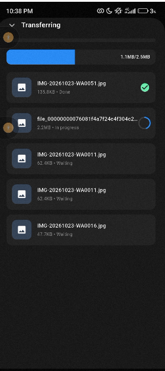
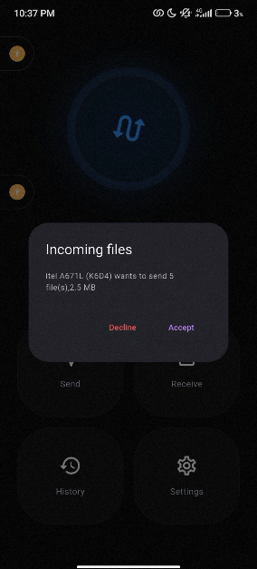
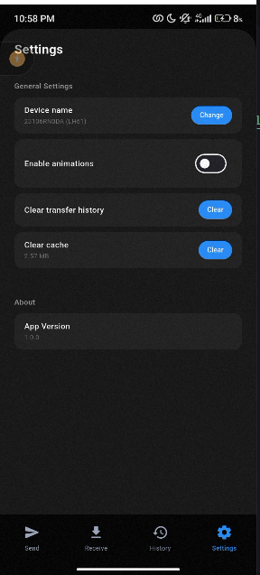
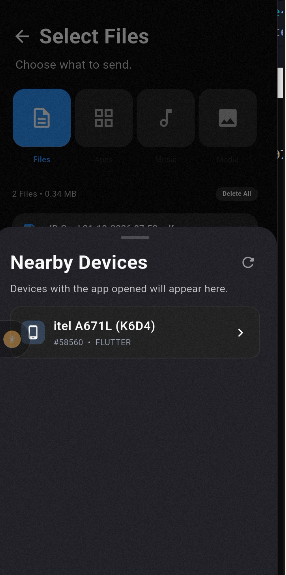

# Flick

A file sharing app I built with Flutter. You basically pick some files, your device search for another phone nearby, and sends the picked file to the phone. Internet connection is not needed, it is just that the two devices should be on the same local network(either they are both connected to the same third party wifi or the receiving phone is connected to the hotspot of the sending device). I built it because it seemed like an interesting project to build.

## What it actually is?

Open the app on both the sending and receiving phones and they find each other on the local network. Pick what you want to send, tap the other phone, and it asks the other person to accept. Once they accept, the files start moving. The app can be used to send photos, videos, music, documents, and even installed apps (as APKs). There's a progress screen so you can watch each file go, and if you leave that screen a little button shows up so you can jump back to it while a transfer is still running. Received photos and videos go straight to the Gallery. Audio goes to Music and everything else goes to Downloads. Users can also see their transfer history as well as change the settings of the app.

## How it works

Basically, both phones need to be on the same local network. Either

- both are on the same Wi-Fi, or
- the sending phone switches on its hotspot and the other receiving phone connects to it

You have to turn the hotspot on yourself. If you don't see the other phone, check that first.

When you hit accept, the receiving phone is running a small local server (shelf) and the sender uploads the files to it (dio). Devices find each other with bonsoir...basically, that is the whole file transfer process in the app.

## Framework used

Flutter

## Download

Get the latest APK from the [Release](https://github.com/Tosin2510/flick/releases/tag/v1.0.0) page.

Not sure which APK to pick? Choose `app-arm64-v8a-release.apk`. It works on almost all modern phones.

## Installing (Android)

1. Download the APK on your phone.
2. Open it and allow installs from unknown sources if your phone asks.
3. Open Flick and accept the permissions.
4. Do the same on the other phone, since both need the app.

## Running from source

Only do this if you want to build the app yourself.

1. Install [Flutter](https://docs.flutter.dev/get-started/install).
2. Clone the repo and run `flutter pub get`.
3. Connect a phone and run `flutter run`.

## The Limitations

- Android only for now.
- Both phones have to be on the same local network.
- Still a work in progress.

## License

MIT License

## Some screenshots from the app.

